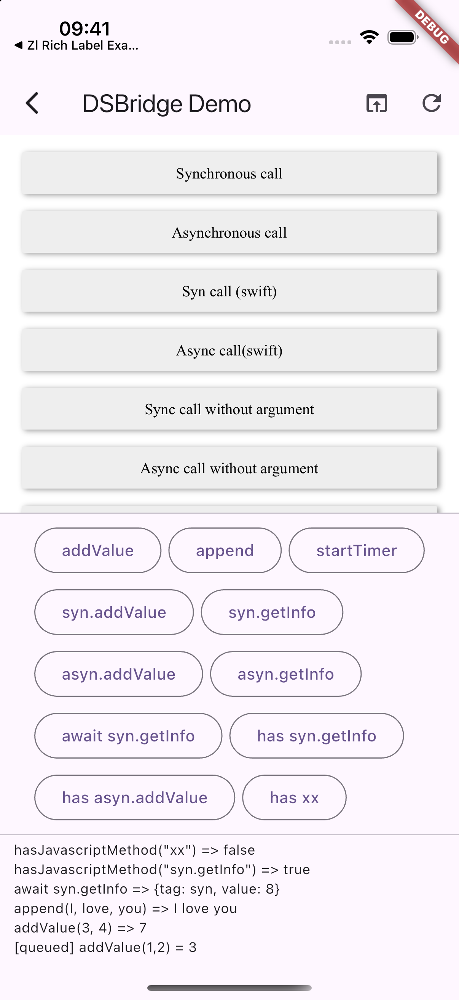
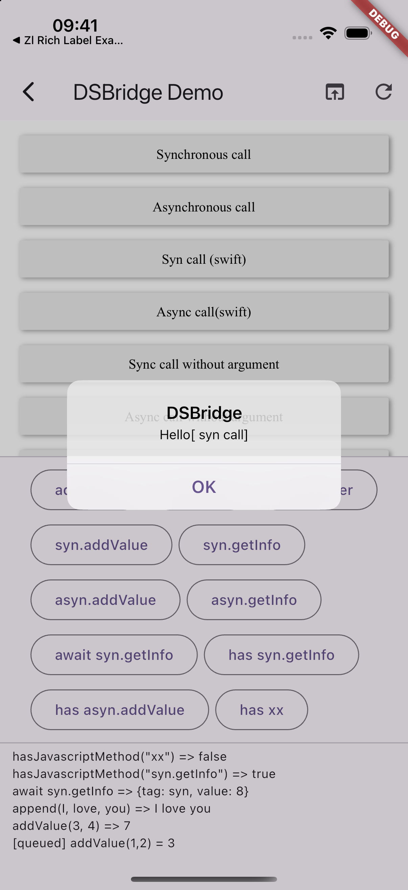
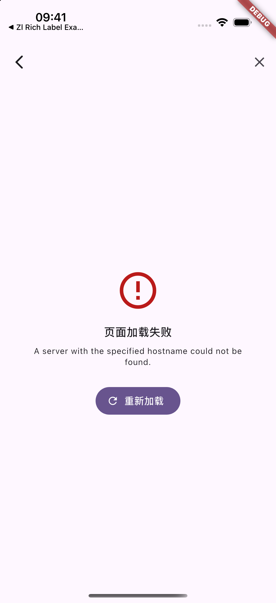

# DSBridge Flutter Demo

[webview_flutter_dsbridge](../README.md) 的示例应用，展示 JavaScript 与 Flutter 双向通信，以及通用 WebView 容器。

## 运行截图

以下图片来自 iPhone 16 Pro 模拟器（iOS 18.1）实际运行的 Debug 版本。

<table>
  <tr>
	<th>示例首页</th>
	<th>Flutter → JavaScript</th>
  </tr>
  <tr>
	<td></td>
	<td></td>
  </tr>
  <tr>
	<td>双向通信及不同网页容器配置的入口。</td>
	<td>同步加法返回 7，异步拼接返回 I love you，并展示 await 和方法检测结果。</td>
  </tr>
  <tr>
	<th>JavaScript → Flutter</th>
	<th>网页加载失败</th>
  </tr>
  <tr>
	<td></td>
	<td></td>
  </tr>
  <tr>
	<td>网页调用 Flutter 的 testSyn 方法，通过弹窗展示返回值。</td>
	<td>访问演示用的不存在域名，展示加载失败提示与重试入口。</td>
  </tr>
</table>

## 演示功能

- **双向通信**：JavaScript 调用 Flutter 同步 / 异步方法；Flutter 调用 JavaScript 并获取回调结果。
- **桥接能力**：命名空间、方法存在性检测、页面初始化前调用排队、连续回调和 `await` 调用。
- **网页弹窗**：`alert`、`confirm`、`prompt` 及弹窗结果展示。
- **网页容器**：自动读取网页标题、自定义标题、隐藏导航栏、加载进度和失败重试。

## 运行方式

在当前 `demo` 目录执行（需要 Flutter SDK，Dart 版本要求见 `pubspec.yaml`）：

```bash
flutter pub get
flutter devices
flutter run -d <设备ID>
```

iOS 运行需要 macOS、Xcode 和已启动的模拟器或可用真机；Android 运行需要 Android SDK 和模拟器或真机。

打开首页的 **DSBridge 双向通信示例** 后：

- 点击上方网页按钮，体验 JavaScript → Flutter 调用。
- 点击下方 Flutter 按钮，体验 Flutter → JavaScript 调用，返回值显示在底部日志区域。
- 双向通信页面使用本地 `assets/web/test.html`，无需外网；Flutter 官网示例需要网络连接。

## 主要文件

- [`lib/main.dart`](lib/main.dart)：示例首页。
- [`lib/pages/dsbridge_demo_page.dart`](lib/pages/dsbridge_demo_page.dart)：双向通信及回调日志。
- [`lib/bridge/js_api.dart`](lib/bridge/js_api.dart)：供 JavaScript 调用的 Flutter 接口。
- [`lib/pages/dsbridge_web_page.dart`](lib/pages/dsbridge_web_page.dart)：通用网页容器。
- [`assets/web/test.html`](assets/web/test.html)：网页端桥接及弹窗示例。
